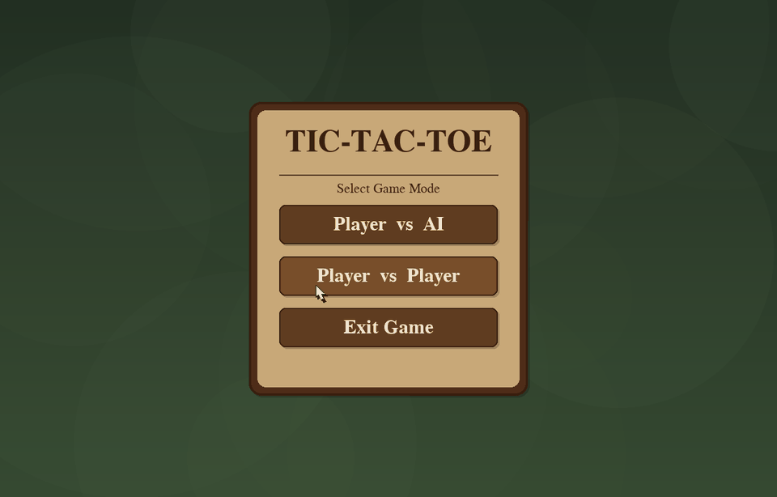

# Tic-Tac-Toe with Deep Reinforcement Learning

A polished, desktop Tic-Tac-Toe game powered by a Deep Q-Network (DQN) agent. Play against the trained AI or challenge another person locally, then explore the reinforcement-learning code and training artifacts behind the agent.


## Gameplay



## Highlights

- **Two ways to play:** take on the trained AI or play a local two-player match.
- **Configurable matches:** enter player names and choose your piece before starting.
- **Polished desktop interface:** resizable window, fullscreen mode, score tracking, restart controls, and an in-game match-history drawer.
- **Reinforcement-learning agent:** a DQN learns from self-play and selects among legal moves using its learned Q-values.
- **Portable inference:** the desktop game can load the saved model without requiring PyTorch at runtime; it uses PyTorch when available as a fallback.
- **Reproducible experiments:** training settings, evaluation code, saved weights, and timestamped training summaries are included.

## How it works

The board is represented as nine values. For the agent, its own pieces are encoded as `1`, the opponent's as `-1`, and empty cells as `0`. A fully connected neural network maps this board state to nine Q-values—one for each possible move. The agent masks out occupied cells and chooses the legal move with the highest value.

The training loop uses:

- **Self-play** to generate experience for both sides.
- **Experience replay** to train on sampled past moves.
- A **target network** to stabilize temporal-difference updates.
- **Epsilon-greedy exploration** that gradually shifts from exploration to learned moves.
- **Legal-action masking** so occupied cells are excluded from move selection and next-state targets.

The saved network has the architecture `9 → 256 → 256 → 9`, with ReLU activations between its linear layers.

## Training snapshot

The latest checked-in training summary records **200,000 self-play episodes**:

| Result during training | Rate |
|---|---:|
| X wins | 17.37% |
| O wins | 7.20% |
| Draws | 75.43% |

These are aggregate outcomes from the recorded self-play training run, **not** a held-out benchmark or a guarantee of play strength. To run the separate evaluation against a random opponent, see [Evaluation](#evaluation).

## Run locally

### Requirements

- Python 3.11 (the included GitHub Actions workflow builds with Python 3.11)
- Packages listed in [`requirements.txt`](requirements.txt)

### Install and launch

```bash
git clone https://github.com/Old-Daoist/TicTacToe-with-Reinforced-Learning.git
cd TicTacToe-with-Reinforced-Learning

python -m venv .venv
```

Activate the virtual environment, then install dependencies and start the game:

```bash
# Windows PowerShell
.venv\Scripts\Activate.ps1

# macOS / Linux
source .venv/bin/activate

python -m pip install -r requirements.txt
python UI/main.py
```

The repository includes the trained weights in [`tictactoe_model.pth`](tictactoe_model.pth). If the model cannot be loaded, the game has a random-legal-move fallback.

## Train and evaluate

Install the requirements first. Training uses the defaults in `dqn_trainer.py` unless a local `config.json` is present:

```bash
python dqn_trainer.py
```

The trainer saves updated weights to `tictactoe_model.pth` and writes a timestamped summary under `Data/`.

Evaluate the saved model against a random opponent:

```bash
python evaluate.py
```

The evaluation script runs 10,000 games with the AI playing first and another 10,000 with the AI playing second, then prints wins, losses, and draws for each role.

## Project structure

| Path | Purpose |
|---|---|
| [`UI/`](UI/) | Pygame menus, game screen, AI integration, and match history |
| [`game.py`](game.py) | Core Tic-Tac-Toe rules and legal moves |
| [`environment.py`](environment.py) | Board observations, legal actions, and rewards for learning |
| [`network.py`](network.py) | PyTorch Q-value network |
| [`dqn.py`](dqn.py) | Epsilon-greedy action selection and DQN helpers |
| [`replay_buffer.py`](replay_buffer.py) | Experience replay storage |
| [`dqn_trainer.py`](dqn_trainer.py) | Self-play training loop and checkpoint generation |
| [`evaluate.py`](evaluate.py) | Evaluation against a random-move opponent |
| [`tictactoe_model.pth`](tictactoe_model.pth) | Trained network weights used by the desktop game |
| [`Data/`](Data/) | Saved training-run summaries |
| [`tictactoe_full_showcase.gif`](tictactoe_full_showcase.gif) | Animated application showcase |
| [`.github/workflows/build_exe.yml`](.github/workflows/build_exe.yml) | Windows and Linux standalone-app build workflow |

## Standalone builds

The GitHub Actions workflow can build standalone Windows and Linux executables. To run it, open the repository's **Actions** tab and trigger **Build Standalone Executables (Windows & Linux)** with **Run workflow**. The resulting executables are uploaded as workflow artifacts.

## Contributors

- **Kunal Kamod** — [Kunal-Kamod25](https://github.com/Kunal-Kamod25)
- **Khumba Lunganlung** — [Old-Daoist](https://github.com/Old-Daoist)

---

*Developed as a Master's Group project in Scientific Computing.*
